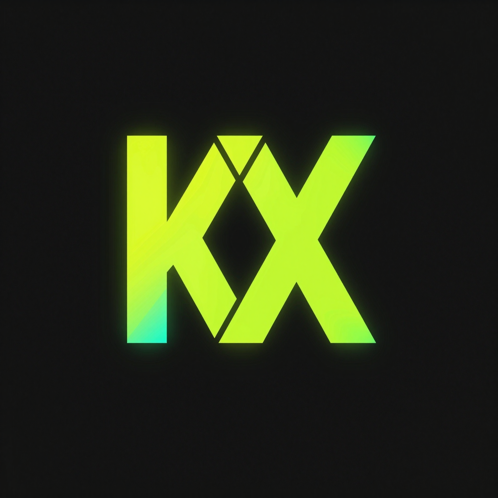

# KINETIX // 2026 Motion Design Showreel

**English** · [Traditional Chinese](./README.zh-TW.md)

> **15-second · 60 FPS WebGL showreel** — a continuous interactive motion-graphics piece with choreography, HUD, and export

<p align="center">
  
</p>

<p align="center">
  <a href="https://github.com/ReiKama414/kinetix-motion-showreel-2026">Star</a>
  ·
  <a href="https://reikama414.vercel.app/">Portfolio</a>
  ·
  <a href="#quick-start">Quick start</a>
  ·
  <a href="#license--rights">License</a>
</p>

---

## Why

A motion showreel should play in the browser as a live stage, not only as a baked video. KINETIX keeps the 15.0s loop on a WebGL canvas so you can scrub acts, change look, and export a master when you need a file

---

## Highlights

- **Five continuous acts** — GENESIS → POLYMORPH → VORTEX SWARM → LIQUID CHROME → CONVERGENCE in one 15.0s timeline
- **Fullscreen stage** — `100dvh` canvas with `object-contain`, so HUD text stays readable
- **Icon rail** — Play, fast rewind, audio, camera, HUD, letterbox, next act, speed, LUT, export
- **Playback speed** — Clear `0.5x` · `1x` · `1.5x` · `2x` menu on the rail
- **Fast rewind restart** — Scrubs backward at high speed, then resumes forward from `00:00`
- **Export** — Record the 1920×1080 · 60 FPS composite to WebM / MP4 via MediaRecorder
- **Brand assets** — Logo and favicons under `assets/brand/`

---

## Tech stack

| Layer | Choice |
| --- | --- |
| UI | React 18 (CDN) · Tailwind CSS |
| Stage | Three.js · custom GLSL |
| Motion | GSAP |
| Audio | Procedural 128 BPM track (user-gated) |
| Serve | `serve` · optional Vite |

---

## Quick start

```bash
npm run start
```

Open [http://localhost:3000](http://localhost:3000)

| Command | Purpose |
| --- | --- |
| `npm run start` | Static server on port 3000 |
| `npm run dev` | Vite preview (optional) |

> **Note:** No `npm install` is required for the default CDN single-page build. Dependencies load from the browser CDNs listed in `index.html`

---

## Usage

| Control | Behavior |
| --- | --- |
| Play / Pause | Toggle the master timeline |
| Fast rewind | High-speed reverse scrub to `00:00`, then play forward |
| Audio | Enable or mute the 128 BPM track |
| Camera | Director cam ↔ free orbit (drag the stage) |
| HUD / Letterbox | Toggle overlays and 2.39:1 bars |
| Next act | Jump to the next 3-second act |
| Speed | Open `0.5x`–`2x` and pick a rate |
| LUT | Cycle color grades |
| Export | Record the full 15s master stream |

### Acts (00:00 – 00:15)

| Act | Window | Title |
| --- | --- | --- |
| I | 00:00 – 00:03 | GENESIS |
| II | 00:03 – 00:06 | POLYMORPH |
| III | 00:06 – 00:09 | VORTEX SWARM |
| IV | 00:09 – 00:12 | LIQUID CHROME |
| V | 00:12 – 00:15 | CONVERGENCE |

---

## Project structure

```
kinetix-motion-showreel-2026/
├── index.html                 # Current UI
├── package.json
├── LICENSE
├── README.md
├── README.zh-TW.md
├── favicon.ico                # Root shortcut for /favicon.ico
├── favicon.png
├── assets/
│   └── brand/                 # Logo · favicons · app icons
└── archive/
    └── motion_showreel_2026.html   # Original single-file build
```

| Path | Role |
| --- | --- |
| `index.html` | Live showreel app |
| `assets/brand/` | Logo and icon set |
| `archive/motion_showreel_2026.html` | Preserved original UI |
| `LICENSE` | **MIT** (open source; not the default All Rights Reserved policy) |

---

## Links

| | |
| --- | --- |
| Repository | [kinetix-motion-showreel-2026](https://github.com/ReiKama414/kinetix-motion-showreel-2026) |
| Author | [ReiKama414](https://github.com/ReiKama414) |
| Portfolio | [Personal site](https://reikama414.vercel.app/) |
| Full license text | [LICENSE](./LICENSE) |

---

## License / Rights

**This project is licensed under the [MIT License](./LICENSE).**  
(Exception to the default All Rights Reserved policy for ReiKama414 projects.)

Copyright (c) 2026 ReiKama414

Permission is hereby granted, free of charge, to any person obtaining a copy
of this software and associated documentation files (the "Software"), to deal
in the Software without restriction, including without limitation the rights
to use, copy, modify, merge, publish, distribute, sublicense, and/or sell
copies of the Software, subject to the conditions in [LICENSE](./LICENSE).

- [GitHub](https://github.com/ReiKama414/kinetix-motion-showreel-2026)
- [Portfolio](https://reikama414.vercel.app/)
- [Full license text](./LICENSE)

---

<sub>KINETIX // 2026 · ReiKama414 · MIT License</sub>
