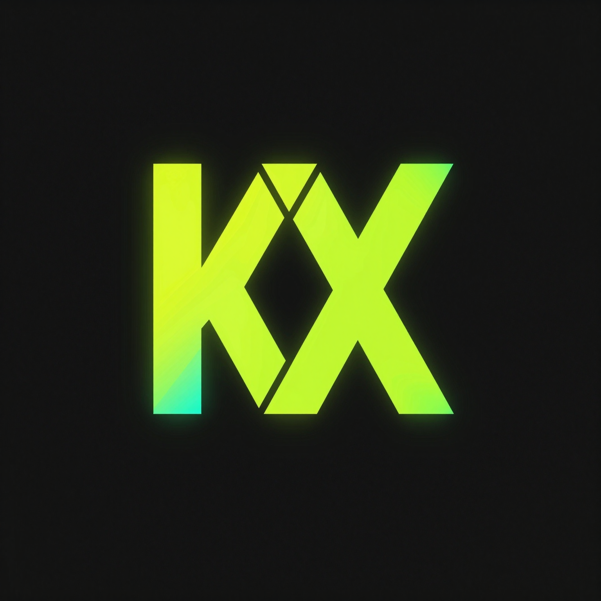

# KINETIX // 2026 Motion Design Showreel

[English](./README.md) · **繁體中文**

> **15 秒 · 60 FPS WebGL Showreel**：連續互動動態設計作品，含運鏡編排、HUD 與影片匯出

<p align="center">
  
</p>

<p align="center">
  <a href="https://github.com/ReiKama414/kinetix-motion-showreel-2026">Star</a>
  ·
  <a href="https://reikama414.vercel.app/">個人網站</a>
  ·
  <a href="#快速開始">快速開始</a>
  ·
  <a href="#license--權限">授權</a>
</p>

---

## 為什麼做

動態 showreel 不該只剩一支烘好的影片，而要能在瀏覽器當即時舞台。KINETIX 把 15.0 秒循環放在 WebGL 畫布上，讓你切段落、調外觀，需要檔案時再匯出 master

---

## 亮點

- **五段連續敘事** — GENESIS → POLYMORPH → VORTEX SWARM → LIQUID CHROME → CONVERGENCE，共 15.0 秒
- **全螢幕舞台** — `100dvh` 畫布搭配 `object-contain`，HUD 文字較不易被裁切
- **右側 icon 列** — 播放、加速倒轉、音軌、運鏡、HUD、遮幅、下一段、速度、LUT、匯出
- **播放速度** — 清楚可選 `0.5x` · `1x` · `1.5x` · `2x`
- **加速倒轉重播** — 高速倒回 `00:00` 後再正向播放
- **匯出** — 以 MediaRecorder 錄製 1920×1080 · 60 FPS 合成畫面為 WebM / MP4
- **品牌資產** — LOGO 與 favicon 集中在 `assets/brand/`

---

## 技術棧

| 層級 | 選用 |
| --- | --- |
| UI | React 18（CDN）· Tailwind CSS |
| 舞台 | Three.js · 自訂 GLSL |
| 動態 | GSAP |
| 音軌 | 程序式 128 BPM（需使用者開啟） |
| 伺服 | `serve` · 可選 Vite |

---

## 快速開始

```bash
npm run start
```

開啟 [http://localhost:3000](http://localhost:3000)

| 指令 | 用途 |
| --- | --- |
| `npm run start` | 於 3000 埠啟動靜態伺服器 |
| `npm run dev` | Vite 預覽（可選） |

> **提醒：** 預設 CDN 單頁不需 `npm install`。依賴由 `index.html` 內的瀏覽器 CDN 載入

---

## 操作

| 控制 | 行為 |
| --- | --- |
| 播放／暫停 | 切換主時間軸 |
| 加速倒轉 | 高速倒回 `00:00`，再正向播放 |
| 音軌 | 開啟或關閉 128 BPM 音軌 |
| 運鏡 | 導演運鏡 ↔ 自由視角（拖曳舞台） |
| HUD／遮幅 | 切換疊加層與 2.39:1 遮幅 |
| 下一段 | 跳至下一個 3 秒段落 |
| 速度 | 開啟 `0.5x`–`2x` 並選擇 |
| LUT | 循環調色預設 |
| 匯出 | 錄製完整 15 秒 master |

### 段落（00:00 – 00:15）

| 幕 | 時段 | 標題 |
| --- | --- | --- |
| I | 00:00 – 00:03 | GENESIS |
| II | 00:03 – 00:06 | POLYMORPH |
| III | 00:06 – 00:09 | VORTEX SWARM |
| IV | 00:09 – 00:12 | LIQUID CHROME |
| V | 00:12 – 00:15 | CONVERGENCE |

---

## 專案結構

```
kinetix-motion-showreel-2026/
├── index.html                 # 現行介面
├── package.json
├── LICENSE
├── README.md
├── README.zh-TW.md
├── favicon.ico                # 根目錄捷徑（瀏覽器自動請求）
├── favicon.png
├── assets/
│   └── brand/                 # LOGO · favicon · app icons
└── archive/
    └── motion_showreel_2026.html   # 原版單檔保留
```

| 路徑 | 用途 |
| --- | --- |
| `index.html` | 現行 showreel |
| `assets/brand/` | LOGO 與圖示組 |
| `archive/motion_showreel_2026.html` | 原版 UI 保留檔 |
| `LICENSE` | **MIT**（開源；非預設的 All Rights Reserved 政策） |

---

## 連結

| | |
| --- | --- |
| 倉庫 | [kinetix-motion-showreel-2026](https://github.com/ReiKama414/kinetix-motion-showreel-2026) |
| 作者 | [ReiKama414](https://github.com/ReiKama414) |
| 作品集 | [個人網站](https://reikama414.vercel.app/) |
| 授權全文 | [LICENSE](./LICENSE) |

---

## License / 權限

**本專案採用 [MIT License](./LICENSE) 開源授權**  
（相對於 ReiKama414 專案預設「保留所有權利」的例外）

Copyright (c) 2026 ReiKama414

在遵守 [LICENSE](./LICENSE) 條件的前提下，可自由使用、複製、修改、合併、發布、散布、再授權與販售本軟體

- [GitHub](https://github.com/ReiKama414/kinetix-motion-showreel-2026)
- [個人網站](https://reikama414.vercel.app/)
- [授權全文](./LICENSE)

---

<sub>KINETIX // 2026 · ReiKama414 · MIT License</sub>
